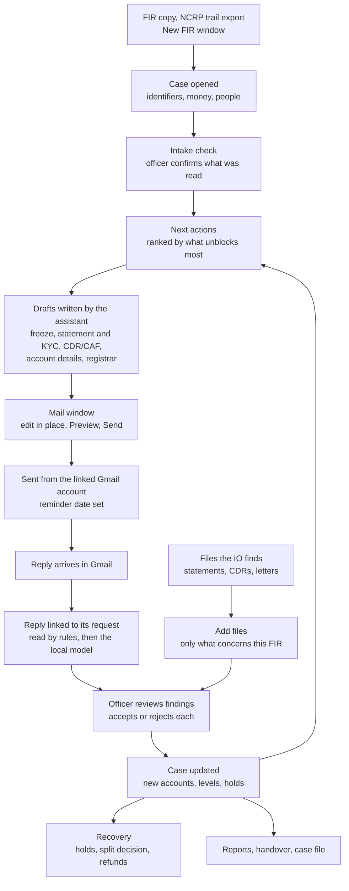

# T-CYBER, end to end

How a cyber-crime FIR goes through T-CYBER, from the first copy of the FIR to the money returned, and how the
system behind it works and is run. Last updated 20 November 2026.

T-CYBER is a working prototype for one police station (PS Madhapur in the configuration). It is not hardened for
production: there is no single sign-on, no rate limiting and no automatic backups (see [Status](#10-status)).

**Contents**

1. [The flow at a glance](#1-the-flow-at-a-glance)
2. [Who uses it](#2-who-uses-it)
3. [Opening a case from an FIR](#3-opening-a-case-from-an-fir)
4. [What the case knows: the accused's side and the money trail](#4-what-the-case-knows)
5. [Next actions](#5-next-actions)
6. [Mails: drafting, editing and sending](#6-mails-drafting-editing-and-sending)
7. [Replies, and files added to the case](#7-replies-and-files-added-to-the-case)
8. [The rest of the case window](#8-the-rest-of-the-case-window)
9. [Running the system](#9-running-the-system)
10. [Status](#10-status)
11. [Inside the code](#11-inside-the-code)
12. [When something goes wrong](#12-when-something-goes-wrong)

---

## 1. The flow at a glance



The loop in the middle is the investigation: every reply or file that names a new account, number or address
proposes the next request about it, and every proposal stays a draft until an officer sends it.

Four rules hold throughout:

- **The investigation is about the accused.** Requests, the graph and the lists centre on the accused's, suspect's or
  offender's accounts, numbers and addresses. The victim's own identifiers are never the subject of a request; the
  one step that touches the complainant's bank is there to find the accused's accounts.
- **Nothing is sent by itself.** Every mail leaves only when an officer presses Send.
- **Nothing read from a document or a reply changes the case by itself.** The officer confirms each fact first.
- **Sections and authorities are never invented.** The sections of law are only those the FIR states. A letter cites
  only the provisions written into the station's own templates and notice headings (for example "Notice U/Sec 94
  BNSS"), never one the system chooses.

---

## 2. Who uses it

Sign-in is with local accounts (demonstration password `tcyber-demo`). Permissions are checked on the server for every
read, change, upload, search, export, graph and assistant question; hiding a button is never the only protection. An
officer who opens a case they are not assigned to gets "not found".

| Role | Who | Can |
| --- | --- | --- |
| Officer | Investigating officers (e.g. `officer1`, SI Krishna) | Work their assigned cases; see the station's case register with other officers' complainants hidden |
| Supervisor | Station supervisor (`supervisor`, Inspector R. Devi) | Every case at the station; approvals on routes that need a supervisor; allocations; settings; connect Gmail; reset the demonstration data |
| Developer | `developer` | The developer console only (knowledge base, ready questions, system audit log) and the procedure assistant; no case or station record |

A station assistant identity writes the drafts the rules propose ("prepared by the assistant"), so that an officer
can approve and send them.

---

## 3. Opening a case from an FIR

**New FIR** (station dashboard) opens a window with three ways in:

1. **Read an FIR copy.** The copy is read in four steps, each reported as it finishes.
   - **CCTNS FIR form:** read item by item by rules wherever the PDF has an English text layer. That covers
     sections, occurrence, complainant, each accused entry, property, the complaint text and officers. Each number,
     website, handle, account and amount gets the role the FIR's own words give it (for example "account the
     complainant paid into", "complainant's own number").
   - **Scanned pages:** transcribed by the local model.
   - **Telugu or Hindi copies:** translated by the local model.
   - **Model output:** whatever the model produced is shown as the model's reading, to check against the original.
   - **Damaged text layers:** PDFs saved from a browser whose text layer drops digits are repaired from the glyph
     shapes.
2. **Add the NCRP money-trail export** (Excel or CSV), with the FIR or on its own. It is read and shown first.
   - When the case opens, its accounts, onward transfers, ATM withdrawals and holds are added, each traced to its sheet
     line.
   - These records are marked "Reported on NCRP" until a bank's own reply confirms them.
3. **Enter it by hand**, when there is no readable copy.

When the case opens, the copy is read again on the server (nothing the browser says about the file is trusted). The
original is kept with its SHA-256 hash, and any model reading is kept beside it as a derived document.

**The sections of law are only those stated in the FIR.** T-CYBER never chooses a section by itself. If the FIR states
none, the case says "not stated in the FIR".

The case opens on **Intake & evidence**, where every detail the reader found is shown where it was found. The officer
confirms each one before it is applied. Applied details are recorded as unverified, with their exact source location;
verifying them is a later, separate step.

The case is also given an investigation vertical, its modus operandi category (`data/MO.docx`): as the FIR states it,
or else by the local model from the brief. The reason is kept and logged.

---

## 4. What the case knows

Every case holds **entities** (accounts, UPI IDs, wallets, phones, emails, profiles, websites, IP addresses, handsets,
people), **relationships** between them, **transactions** and **holds**. Every fact keeps its source: the FIR line,
the reply, the statement row, or the officer who entered it.

### Whose side an identifier is on

- **The victim's own:** the complainant's accounts, numbers and email. This means marked as the victim's, or written
  as "complainant's own …", "Victim 2's account", "complainant's mobile number".
- **The accused's side:** named as the accused's, a suspect's, a fraudster's or a mule's, or reached by the victim's
  money.
- **Not placed yet:** everything else.

### Levels in the money trail

- A payment from the victim is **level 1**.
- Money leaving a level-1 account is **level 2**, and so on.
- Levels are recomputed whenever a movement is recorded, because records arrive out of order.
- A number or UPI ID linked to an account by a record (for example the account's registered mobile) stands at that
  account's level.

These two ideas drive the screens:

- **People & identifiers** has a filter *In the money trail*: Everyone · Accused / suspect · Level 1 · Level 2 · … ·
  Victim's own. The accused and suspects are listed before the victims.
- **Person cards.** Each person on People & identifiers opens a card: what the records say about them (each fact
  with its source), the numbers and accounts linked to them, the requests and replies about those, and the officer's
  own details (name, alias, father's or husband's name, age, gender, address, occupation, notes, side). The records'
  facts update as replies are applied; the officer's details are kept beside them, never over them, and every change
  is in the audit log with the before and after. A save over someone else's newer change is refused.
- **Names and codes.** People are P1, P2… and victims V1, V2… (the complainant is V1). Once a record or an officer
  gives a name, the card reads "P. Kiran (P1)", "Suresh (V1)"; until then "Person P1", "Victim 1".
- **Graph & timeline** shows the accused's side. The victim's paying accounts stay as where the money came from; a
  checkbox *The victim's own details* brings back the rest.

---

### How things are written

- **Identifiers in full.** Account numbers, mobile numbers, references and email addresses are shown in full
  everywhere, drafts and letters included. A value the source itself masked (an FIR copy's `XXXXXXXX4471`) is shown
  as the source gave it.
- **Sections, section first.** "318(4) BNS, 66D IT Act" on every screen, draft and letter. Only the order changes:
  the sections are those the FIR states, in its own wording (`66-D` stays `66-D`); text that cannot be read with
  certainty is shown as written (`src/domain/legal-sections.ts`).
- **References that name the kind of request and its case.** A request is `<kind>.REQ-<FIR no.>/<year>-<serial>`:
  `P.` preservation, `R.` records (statement, KYC, CDR, subscriber or account details), `H.` hold (debit freeze),
  `U.` release (unhold). For example `R.REQ-412/2026-002`; its reminders `R.REQ-412/2026-002-R1`; the reply to it
  `R.RES-412/2026-002` (a second reply `R.RES-412/2026-002-2`). The serial is the request's number in its case,
  whatever its kind. A case registered only on the NCRP portal uses its acknowledgement number. A reply quoting the
  reference with or without the letter (`REQ-412/2026-002`) is matched, and so is one quoting the reference a request
  had before this format (`REQ-2026-0275`), kept as its legacy reference: the request page shows it ("Sent as …") and
  search finds it (`src/domain/request-ref.ts`; existing requests were moved by `scripts/migrate-request-refs.ts`,
  which is safe to run again).
- **Sorting.** Clicking a column heading sorts a list by that column; clicking again reverses it. Dates and amounts
  sort by value, text as read, empty values last. The station's nodal list sorts on the server, across all its pages.

## 5. Next actions

Rules derive the next actions from the case's records (`src/domain/recommendations.ts`) and rank them by what unblocks
the most. Each says why, in one plain line, with its sources.

### What each identifier gets

| Identifier | Next action |
| --- | --- |
| An account or UPI ID the victim's money reached | Ask its bank to **freeze** it (debit freeze, balance at the time of the freeze), and for its **statement and KYC**; one ATM-details line per cash withdrawal |
| The complainant's own account, when no receiving account is known yet | **Find the accused's accounts:** ask the complainant's bank which accounts got the money (beneficiary account, IFSC and UTR of each debit) |
| No account known at all | **Find the accused's accounts:** add the NCRP trail, or the complainant's statement or screenshots, with *Add files* |
| An Indian phone number used by the caller | **CDR and CAF** through the UNICROSS desk (Zonal ACP) |
| A WhatsApp number (Indian or foreign) | **WhatsApp:** registration details and IP logs |
| An email address or online profile of the accused | **Account details** from the provider: name and date of registration, registered phone numbers and recovery email, IP addresses of registration and logins, accounts linked by the same phone or email, and keeping the records meanwhile |
| A website used in the fraud | The **registrar**: registrant, payment, hosting and logins |
| An IP login without port and time | The **source port and exact time** from the bank that reported it |
| A request with no reply by its follow-up date | A **reminder** with what is still outstanding |
| Held money shared between victims | A **decision** on how to split it (proportional, first in first out traced through the trail, or the court) |

The victim's own phone, email and accounts are never asked about.

A freeze is only ever asked for an account the money reached; an email or profile is never "frozen". In demonstration
cases a platform profile still gets a preservation request first, because the demonstration directory's portals take
one.

### Actions that wait for something

- **Waiting on an unknown address:** a real case writes only to addresses on the nodal officer list, never to the
  demonstration directory. An action whose bank, mail host, platform or registrar is not known yet waits, and says
  what to record and how to find it. Once the detail is recorded, the request is drafted to that addressee.
- **Drafting without the address:** a request can also be drafted without its addressee, with a line
  "[…: to be filled in]". With Gmail, typing the real To address and filling that line is enough to send it.
- **Drafted automatically:** drafts are written as soon as an officer's action records the facts that call for them
  (`requests.autoDraft`). Low-priority proposals wait for the officer.
- **Defer:** sets an action aside with a reason; it can be restored from the Deferred tab.
- **Dismiss:** sets a lead aside with a reason; new evidence can reopen it.

---

## 6. Mails: drafting, editing and sending

### How mail leaves the station

`delivery.mode` in the configuration file chooses one of three:

| Mode | What happens on Send |
| --- | --- |
| `gmail` (in use) | Sent from the linked Gmail account to the address typed. Every unsent request is also kept in that account's Drafts, and edits made in either place are copied to the other |
| `via-io` | Mailed to the IO's mailbox (simulated, or SMTP from `.env`); the IO forwards it from their own mailbox and marks it forwarded |
| `direct` | Through the simulated adapters (bank email gateway, UNICROSS, NPCI); a synthetic receipt is returned |

The rest of this section describes Gmail mode.

### The mail window

Opening a drafted action in **Next actions**, a request's **Open the mail**, or **New mail** shows the mail itself with
every part editable in place:

- **From:** the linked Gmail account (not editable: it is the account the mail goes from).
- **To:** up to 5 addresses, separated by commas. Addresses from the nodal officer list, or verified in the directory,
  are offered as one-tap chips.
- **Subject** and **mail text.**
- **Asks for:** the items the request lists. Unticking one removes its line from the text; ticking it puts the line
  back.
- **Attached:** case files, or a file from the computer (also kept in the case files), up to about 18 MB in all
  (Gmail's limit is 25 MB once encoded).
- **Copy icons** beside To, Subject and the text, and one for the whole mail, to paste into any other mailbox.
- **Letter for printing:** PDF or Word on the station letterhead, with the notice heading the station configures.
  The letter is marked DRAFT, with the reason, until the address is known (typed or verified) and every
  "[…: to be filled in]" line is filled.
- **Buttons:** **Defer** · **Preview** (the mail as it will go, read-only) · **Send**.

Everything is saved as it is typed.

- **The working copy.** What is typed is kept as the request's working copy. It becomes a version (versions are never
  changed once written) when the window closes, when the mail is sent, or after typing has paused for about two
  minutes. Then the Gmail draft is updated.
- **Changes made elsewhere.** If the mail was changed elsewhere meanwhile (in Gmail, or by another officer), the
  window says so and offers *Load the latest* or *Keep mine*.

**Send checks every field first.** A field that is not right gets a red border and a short reason under it, and a line
at the top names them, for example *Invalid: To, Mail text*. The checks:

- **To:** at least one real address, at most five. Placeholder domains (`example.invalid`, `.test`, …) cannot receive
  mail.
- **Subject:** 5 to 250 characters.
- **Mail text:** at least 20 characters, with every "[…: to be filled in]" line filled.
- **Attachments:** every attached file still in the case, about 18 MB in all at most.
- **Asks for:** at least one item ticked.

The red marks clear as soon as the field is edited.

**Approval.** With `gmail.senderApproves` on (it is), the officer who presses Send approves the version they send, even
when they wrote it; this is logged as "approved by sending". A route that needs a supervisor still needs one: the
button then reads *Send for approval* and the supervisor sends it from the same window. With the setting off, another
officer approves a version its author wrote.

**After sending:**
- It is in the account's Sent folder.
- The request records the Gmail conversation, so a reply in it links back.
- A follow-up date is set from the route (for example 2 days for a freeze, 5 for a bank statement, 15 for account
  details).
- If nothing comes back by then, a reminder is drafted.

### New mail

**New mail** (case page and Requests) writes a mail to any address, not proposed by the rules. Nothing is kept until
something is typed.

- **First save:** the mail becomes one of the case's requests with its own R-number and reference, and the reference
  is added to the end of the subject.
- **Addressee:** the address typed.
- **Approval:** investigating officers approve it.
- **Discard:** marks it discarded before sending. It is kept on record and leaves every list; its Gmail draft is
  removed.

### The Gmail link, in detail

- **Background pass:** every 20 seconds (`gmail.syncSeconds`), and straight after an edit, T-CYBER compares a
  fingerprint of To, Subject, text and attachments with both sides.
  - **Changed only in T-CYBER:** the Gmail draft is updated.
  - **Changed only in Gmail:** the edit becomes a new version under the IO, and any approval is withdrawn. Gmail's
    hard line-wrapping is undone: only the changed words are taken.
  - **Changed on both:** the newer one wins and the other is kept as a note on the request.
- **Missing addressee:** a draft with no addressee yet goes to Gmail with an empty To line.
- **Deleted in Gmail:** a draft deleted in Gmail is not silently recreated; the window says so, and it is put back
  when sent.

---

## 7. Replies, and files added to the case

### Replies read from Gmail

With the read permission granted (see [Connecting Gmail](#connecting-gmail)), each pass also looks at new messages in
the inbox, each once. The headers decide first whether a message can be about a request:

- it is in the Gmail conversation a sent request started, or
- its subject quotes a request's reference (REQ-…), or
- it comes from the exact address a request was sent to, or
- it comes from the mail domain of an organisation a request went to, its subject speaks of a request, notice, FIR or
  the like, and its text names the case (the FIR, the identifier asked about, the reference).

**Shared domains** (gmail.com, yahoo, outlook, mail.com, nic.in, gov.in and similar) count only by exact address,
because many unrelated people use them.

**Mail that is none of these is not about a case.** Only its message ID is kept, never its content, and it is never
shown to the model. This matters because the linked account may be someone's personal Gmail.

A message that is about a request is read in full, attachments included. Then:

1. **Certain:** if the conversation or the reference names the request, or the matching rules are sure enough, it is
   linked to that request and read into the case.
2. **Unsure:** the local model is asked which of the possible requests it answers, with an exact line from the
   message as its reason. That line is checked against the message. The reply is linked when the rules agree.
3. **Otherwise:** it waits in *Import a reply → From the station inbox*, with the suggestion, for an officer to match.

### Other ways a reply comes in

*Import a reply* (case page and Requests) has two tabs:
- **From the station inbox**, including Gmail replies that were not certain.
- **From a file or letter:** a portal download, a letter or a pen drive. It takes up to 5 files of 25 MB each, with
  the request it answers chosen or matched automatically.

Duplicate imports are detected and ignored.

### Reading a reply

Replies are untrusted data: their text is only matched for facts, and no instruction in a message or attachment is
ever followed.

- **Rules first.** Rules read the text and the attachments:
  - bank statements in CSV and Excel, in the bank's own layout;
  - hold confirmations, KYC, CDR and CAF.
- **Then the local model.** What the rules cannot place, such as a platform's, registrar's or mail provider's
  free-text answer, is read by the local model on this server. Every fact must quote the reply and is checked against
  it; a fact that fails the check is dropped.
- **Officer review.** Each finding is proposed for the officer to accept, edit or reject on the reply's review page.
  Only accepted findings change the case.
- **What follows.** New accounts, numbers, holds and statement rows update the money trail and levels, and draft the
  next requests they call for.

### Add files

*Add files* on the case page takes the files an IO finds: an accused's 15-day or month-long bank statement, call
records, the NCRP export, letters, KYC copies or screenshots. It takes up to 10 files of 25 MB each, as PDF, XLSX,
CSV, DOCX, TXT, EML, PNG or JPG (save .xls as .xlsx first).

Each file is stored as evidence and read against the case. The aim is to keep only what concerns this FIR.

- **Bank statement:**
  - It finds which case account the statement belongs to, then follows the complainant's money out of it until it
    has all left.
  - **Kept:** onward transfers, new accounts and UPI IDs, ATM withdrawals and matching references.
  - **Confirmed, not added again:** a movement the case already records.
  - **Reported but not added:** card purchases, the balance left, and a pattern of many small payments from
    strangers, which often marks a mule account.
  - **Left out, with a count:** salary, groceries and other unrelated entries.
- **Call records:** calls with the case's numbers, the handsets used, and cell towers within a day of the offence.
- **Letters and documents:** mentions of case identifiers, new identifiers written beside them, and holder names. The
  local model adds a short summary, and every point it makes must quote the file.

Nothing is added until the officer reviews the list, unticks what they do not want, and presses *Add to the case*.
Re-adding the same file is recognised and adds nothing.

---

## 8. The rest of the case window

- **Overview:** where the case stands (money held and traced, who did it, what changed since you last looked, what
  it waits on), and the buttons *Import a reply · Add files · New mail · Case context · Review next actions*.
- **Case context:** everything the case holds in one window, built fresh from the records each time:
  - the case as the FIR states it;
  - the money trail level by level, with holds;
  - who is on which side;
  - every mail with what it asked for, what came back and what is still awaited;
  - replies not yet linked;
  - what is pending;
  - the files, and the open next actions.

  It can be copied or downloaded as text. The case assistant's local model is given the same mail and reply lines
  when it answers.
- **Transactions & recovery:** a ledger in paise from bank records only. It shows per-account and per-victim
  positions, holds, the split decision when victims' money was mixed (a supervisor confirms the allocations), a
  refund preview that records nothing, restorations, the victim call log and a CSV export.
- **Requests & responses:** every request with its versions, approvals, submissions, notes, reminders and replies.
  Rows waiting for the officer come first.
- **Graph & timeline:** money flow, identity links and discovery phases, with filters and a mark-as-reviewed point.
- **Assistants:**
  - **Case assistant:** answers about one case. Rules answer first; the local model answers what the rules cannot,
    citing each fact it used.
  - **Procedure assistant:** answers from the station's approved library (SOPs, circulars, the law, provider
    policies). A question can carry up to 8 attachments: FIR copies, other files, station mails, whole cases.
    *What connects these?* lists every account, UPI ID, number, email, website, IP address or reference written in
    more than one of them, with where. A partly hidden account number is only "possibly the same", and a matching
    name is never treated as the same person.
  - **Saved conversations:** both assistants keep them (rename, search, export to Word or text, archive, delete,
    retry).
- **Activity & audit:** every change, with who and when. Audit entries, request versions and report versions cannot
  be changed or deleted; the database refuses it.
- **Reports & handover:** reports cite their sources; a handover moves a case to another officer. The case file is
  a ZIP of every original and derived text with recorded and recomputed hashes, the ledger and the audit log, and
  each export is logged.

Outside the case window:
- **Station dashboard:** cases, what needs action today, figures and trends, replies inbox and notifications.
- **Search:** only the cases you can open.
- **Correspondence:** every request and reply across your cases.
- **Settings:** see the next section.

---

## 9. Running the system

### The service

On the server the app runs as the systemd user service `t-cyber` (port 3000, dev mode, so code changes show up live).
Open it at `http://192.168.1.15:3000` or `http://spark-2850-1:3000`.

```bash
scripts/service.sh status         # state and addresses
scripts/service.sh restart        # after installing packages or changing background code
scripts/service.sh clean-restart  # with an empty dev cache, if pages look stale
journalctl --user -u t-cyber -n 100 --no-pager   # recent log
```

While the service runs, never start `npm run dev` and never `pkill` the server. It restarts itself if it exits, and a
health check restarts it if it stops answering.

### The configuration file

`config/t-cyber.config.json` (or the file in `T_CYBER_CONFIG`) is re-read on the next page load; no restart is needed.
An invalid file keeps the last valid one in use and Settings shows the error.

| Section | Controls |
| --- | --- |
| `station` | Code, name, district, address, phone, email, letterhead lines |
| `mailbox` | Station From address, display name, valediction, signature |
| `delivery` | `mode` (gmail, via-io, direct), the IO mailbox, transport for via-io |
| `gmail` | `enabled`, `account`, `credentialsFile`, `tokenFile`, `syncSeconds`, `senderApproves`, `readReplies` |
| `requests` | Reference prefix (`REQ`), default follow-up days, `autoDraft`, notice headings per kind of request |
| `directory` | The recipient directory (banks, UNICROSS, NPCI, portals): channel, address, IFSC prefix, kinds of request, verified, synthetic |
| `ai` | The local model: provider, host (loopback only unless `allowNonLocalHost`), model, timeout |

Routes, templates, recipient verification and the nodal officer list are kept in the database and edited in Settings.
A recipient whose address changes in the file becomes "not verified" until a supervisor verifies it again.

### Connecting Gmail

The OAuth client file is `data/secrets/gmail-credentials.json` and the token is `data/secrets/gmail-token.json`
(folder mode 700, files 600, never committed, never shown).

To connect:
1. A supervisor opens Settings → Integrations → Gmail → *Connect Gmail* (or *Connect again*), or runs
   `npm run gmail:connect` on the server.
2. Sign in on Google's page and allow both permissions: manage and send drafts, and read the email (for replies).
3. The browser lands on an address starting `http://localhost/?` that does not load. Paste that address back.

Notes:
- **Testing mode:** while the Google Cloud project is in testing, Google warns the app is unverified (choose
  Continue) and ends the permission after 7 days. T-CYBER then says so, and a supervisor connects again.
- **Reconnecting** the same account keeps the date the link began.
- **The Integrations page** shows whether it is connected, whether replies are being read, and the last check.

### The local model

The local model is optional. Run it with `sudo systemctl enable --now ollama` and `ollama pull gemma4:26b`. Without
it, everything that needs it says so and falls back to rules or to the officer.

It runs on this server only; case documents never go to a remote model. It is used for:
- scanned pages and Telugu or Hindi copies;
- replies the rules cannot place, and summaries of added files;
- assistant answers the rules cannot place;
- choosing which request an unsure reply answers.

### Other tasks

| Task | How |
| --- | --- |
| Import the CrimeOS nodal officer list | Settings → Nodal officers, or `npm run nodal:import` |
| Import the knowledge base | Developer console, or `npm run kb:import` (see [`KNOWLEDGE_BASE.md`](KNOWLEDGE_BASE.md)) |
| Re-work every open real case's next actions with the current rules | `npm run actions:refresh` (drafts only; nothing is sent; every change is logged) |
| Reset the demonstration data | Settings → Demonstration data (supervisor, type `RESET`), or `npm run db:reset`; everyone is signed out |
| Back up the database (not automatic) | `sqlite3 data/t-cyber.db ".backup '/path/to/backup.db'"`, plus the `data/storage` folder of originals |

### Comment mode (UI notes, development only)

On a development build (the service as it runs now), every signed-in page has two buttons at the bottom left:
**Comment** and **Notes**.

- **Leave a note:** press *Comment* (or Alt+Shift+C), then click any block. It is outlined, and a box asks what
  should change. *Wider block* moves to the block around it. Alt+click works at any time without turning the mode on.
- **The app is paused while commenting:** clicks go to the comment box, not the app, and windows stay open. Escape
  closes the box, then stops commenting.
- **What a note keeps:** the page, the block's place in it, its text, nearest heading and window, its size and a
  trimmed copy of its HTML. It also keeps a picture: of the block when it is on the page as it loads, or of the page
  when the block was in a window.
- **Pins and the Notes panel:** a numbered pin marks each open note. *Notes* lists this page's notes and all pages'
  notes, with *Show*, *Picture*, *Mark done* and *Remove*.
- **For the developer:** `npm run ui:notes` lists the open notes, with each picture's path.
  `npx tsx scripts/ui-notes.ts done <n> "what was changed"` marks one done; the reply then shows under the note.

The notes and pictures are kept in `data/ui-notes/` on this server only; nothing is sent anywhere, and the pictures
are taken by a headless browser on this server. A production build has none of it (set `T_CYBER_UI_NOTES=1` to
switch it on there).

`data/` holds the database, the stored originals, the secrets and the sample FIR copies; none of it is committed.
Real FIR copies in `data/samples` stay on this server.

---

## 10. Status

### Real

- Mail drafted, edited and sent from the linked Gmail account.
- Replies read from that account's inbox.
- Everything inside T-CYBER: reading, rules, the ledger, the audit log.

### Simulated (labelled in the app)

- **The other delivery modes:** the bank email gateway, the UNICROSS desk route and the NPCI route (synthetic
  receipts), and mail to the IO's mailbox unless SMTP is set.
- **Provider portals:** the officer submits on the portal and records its reference.
- **Demonstration data:** the demonstration cases, directory, people and documents are synthetic. Use `example.invalid`
  addresses in them.

### Not done

- **Production hardening:** single sign-on, deployment hardening, a strict content security policy, rate limiting,
  automatic backups.
- **Without the local model:** scans are not read.
- **PDF bank statements:** not read as tables by rules; the model proposes payments from them, each checked against the
  text.
- **Lookups:** no WHOIS or DNS lookups leave the server; the officer records a website's registrar or a domain's mail
  host.
- **Call records:** they link only on exact phone numbers.
- **NCRP export columns:** the mapping is a best guess until a real export confirms it.
- **Testing:** not tested with assistive technology, or beyond Linux and Chromium.

---

## 11. Inside the code

### Stack

Next.js 16 (App Router, Turbopack) and React 19, TypeScript, Prisma 7 on SQLite (`data/t-cyber.db`), Zod, Tailwind,
Vitest and Playwright. The local model is Ollama (`gemma4:26b`). Node 24.

### Layout

| Folder | Holds |
| --- | --- |
| `src/app` | Pages and API routes: `(station)` dashboard, settings and search; `(case)/cases/[caseId]/…` the case window; `api/…` uploads, downloads and imports |
| `src/features/<area>` | Screens and server actions per area (case, requests, responses, funds, graph, assistant, settings, station, …) |
| `src/server/services` | The work: one file per job (see below) |
| `src/server/gmail` | OAuth, the Gmail API wrapper, draft sync, reply reader, background runner |
| `src/server/ai` | The local model client, grounding, case context for the assistant |
| `src/domain` | Pure rules with no I/O: recommendations, levels, ledger, reply matching, mail checks, identifiers, permissions |
| `src/contracts` | Shapes shared by server and screens |
| `prisma` | Schema, hand-written migrations, seed |
| `config` | The station configuration file |
| `scripts` | Service control, imports, refresh, Gmail connect, demo reset, visual audit |
| `tests` | `unit`, `integration` (each file on its own database copy), `e2e` |

### Where each step lives

| Step | Files |
| --- | --- |
| Reading an FIR, opening a case | `services/fir-reading.ts`, `fir-open.ts`, `extraction.ts`, `intake-view.ts`, `domain/extraction` |
| NCRP export | `services/ncrp-trail.ts`, `domain/ncrp-trail.ts` |
| Next actions and drafting | `domain/recommendations.ts`, `services/tasks.ts`, `next-actions.ts`, `drafting.ts`, `auto-draft.ts`, `draft-gaps.ts`, `domain/plain-line.ts` |
| Request lifecycle and approval | `services/requests.ts`, `domain/request-workflow.ts` |
| Mail window and New mail | `services/mail-window.ts`, `domain/mail-check.ts`, `features/requests/components/mail-window.tsx`, `new-mail.tsx`, `open-mail.tsx` |
| Gmail | `gmail/oauth.ts`, `connect.ts`, `api.ts`, `sync.ts`, `replies.ts`, `runner.ts`, `view.ts`; `domain/text-merge.ts` |
| Replies | `services/responses.ts`, `reply-reader.ts`, `inbox.ts`, `import-summary.ts`, `domain/reply-match.ts`, `reply-reading.ts` |
| Add files | `services/case-files.ts`, `domain/file-reading.ts`, `features/case/components/add-files.tsx` |
| Money | `services/funds.ts`, `layers.ts`, `allocation-decision.ts`, `recovery-view.ts`, `domain/ledger.ts`, `money.ts` |
| People, graph, context | `services/people-view.ts`, `graph.ts`, `case-context.ts`, `features/graph/model.ts` |
| Assistants | `services/assistant.ts`, `procedure-assistant.ts`, `chats.ts`, `ai/grounded.ts`, `ai/context.ts`, `domain/connections.ts` |
| Records | `server/audit.ts`, `services/case-file.ts`, `reports.ts` |

### Data model

There are 56 tables. The ones the flow runs on:

- **Case and its people:**
  - `Case`, with `CaseAssignment` (who works it).
  - `Entity` (every identifier and person; a person's officer-entered details sit in its attributes under
    `officer`), with `PartyRole` and `Relationship`.
  - `VictimClaim`, `LocationObservation`, and `SourceAssertion` (which record states each fact, where).
- **Documents:**
  - `EvidenceItem` (originals and derived texts, hashed), with `EvidenceSegment` and `ProcessingEvent`.
  - `ExtractionRun` and `ExtractionCandidate` (intake checks), and `FileReading` (Add files).
- **Money:** `Transaction` (with its `layer`), `Hold` and `HoldEvent`, `Allocation`, `AllocationDecision` and `Refund`.
- **Requests:**
  - `Request` (its reference and serial in the case, the legacy reference, status, Gmail draft and thread, the
    typed To, the working copy).
  - `RequestVersion` (append-only), `RequestItem`, `RequestSubject`, `Approval`, `Submission` and `RequestNote`.
  - `Recipient`, `RoutingRule`, `Template` and `NodalContact`.
- **Replies:**
  - `Response` and `ResponseFinding`.
  - `InboxMessage` (the station inbox, including Gmail replies for an officer to match).
  - `GmailSeen` (each Gmail message looked at, its content kept only when it is about a case).
- **Work and records:** `Task` (next actions), `AuditEvent` (append-only), `Report` and `ReportVersion`, `ChatThread`
  and `ChatMessage`, and `KnowledgeDocument`.

### Changing the schema

Prisma's `migrate dev` does not run non-interactively, so:

```bash
npx prisma migrate diff --from-migrations prisma/migrations --to-schema prisma/schema.prisma --script
# save as prisma/migrations/<timestamp>_<name>/migration.sql (hand-tidied: ALTER TABLE … ADD COLUMN where possible)
npx prisma migrate diff --from-migrations prisma/migrations --to-schema prisma/schema.prisma --script   # must print "This is an empty migration."
sqlite3 data/t-cyber.db ".backup 'backup.db'" && npx prisma migrate deploy && npx prisma generate
scripts/service.sh restart
```

### Background work

`src/instrumentation.ts` starts two runners when the server starts.

The Gmail runner (`server/gmail/runner.ts`). Each pass:
1. turns mail-window working copies left idle for two minutes into versions;
2. syncs drafts both ways;
3. reads new inbox messages for replies.

The case upkeep (`server/upkeep-runner.ts`, `services/upkeep.ts`), a minute after start and then every 15 minutes
(`T_CYBER_UPKEEP_MINUTES`; `T_CYBER_UPKEEP=0` switches it off, as the browser tests do):
1. works out each open case's next actions again, so what comes due with time alone (a follow-up date passing) shows
   in Next actions on time;
2. drafts each due reminder as the assistant, for the investigating officer to check and send (with
   `requests.autoDraft` on). Nothing is sent. Like every unsent draft, the reminder is copied to Gmail Drafts by the
   Gmail sync when the Gmail link is on, demonstration cases included.

There is one pass of each at a time, and a failure on one request or case is recorded without stopping the others.
After changing background code, restart the service.

### Tests

```bash
npx vitest run                 # 731 unit and integration tests in 85 files (a few minutes)
npx eslint src tests scripts
npx tsc --noEmit               # errors only under .next/types come from an old build and can be ignored
npm run test:e2e               # Playwright end-to-end tests on their own database (port 3100)
```

Tests never reach Google or the model: `T_CYBER_DISABLE_NETWORK=1` is set, and Gmail and the model are replaced by
in-memory stand-ins. Each run builds its own template database in `data/test/run-…` and every test file works on a
copy of it; a test that cannot find its copy refuses to start rather than touch the station's database. Test data is
synthetic only.

---

## 12. When something goes wrong

| What you see | What to do |
| --- | --- |
| "Google has ended T-CYBER's access to Gmail" | The permission expired (7 days in testing mode) or was removed: connect again in Settings → Integrations |
| Integrations shows "Needs the read permission" | Connect again and tick *read your email* on Google's page |
| "Could not update the Gmail draft: …" on a draft | It is tried again on every pass; *Check Gmail now* in the mail window tries at once |
| "This draft is no longer in Gmail's Drafts" | It was sent or deleted in Gmail; Send puts it back and sends it |
| "This mail was changed elsewhere" in the mail window | Choose *Load the latest* (take the other change) or *Keep mine* |
| A reply did not link to its request | Find it under *Import a reply → From the station inbox* (with a suggestion) and match it; replies from a gmail.com or nic.in address link only if they come from the exact address the request went to |
| "The local model is not running on this server" | `sudo systemctl enable --now ollama`; Settings → Integrations shows when it is ready |
| Settings shows a configuration error | Fix `config/t-cyber.config.json`; the last valid one stays in use meanwhile |
| Pages look stale or show a hydration error for fixed code | `scripts/service.sh clean-restart` |
| An action says it waits for a bank, mail host or registrar | Record it under People & identifiers (the action shows how to find it); the request is then drafted |
